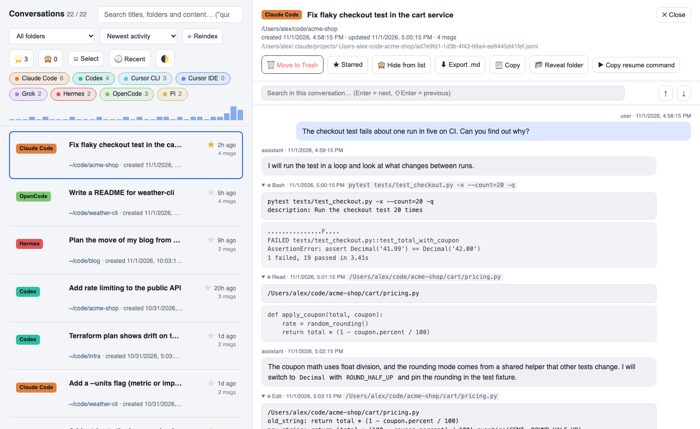
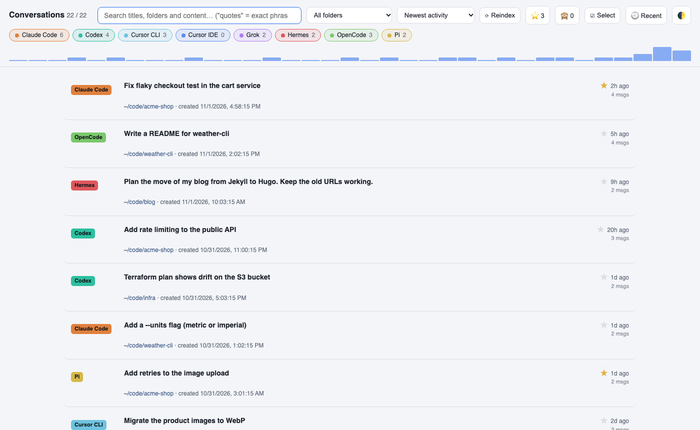
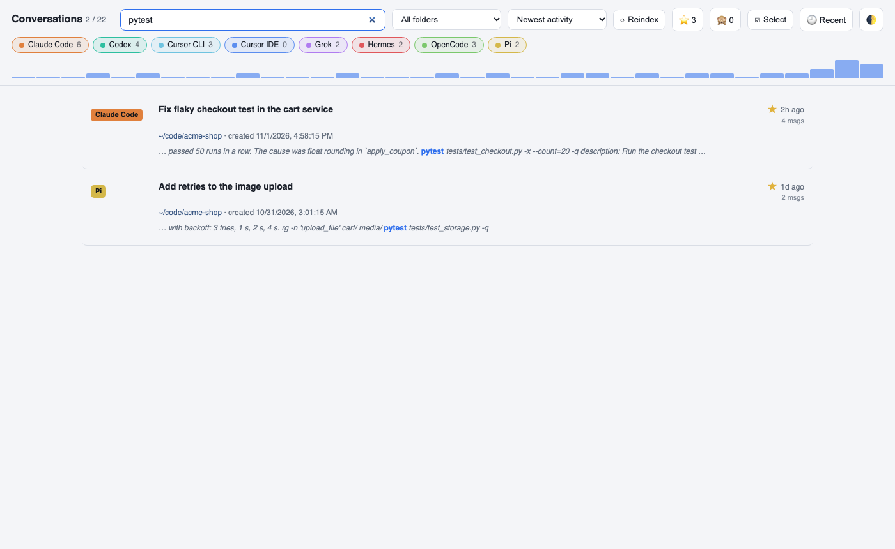
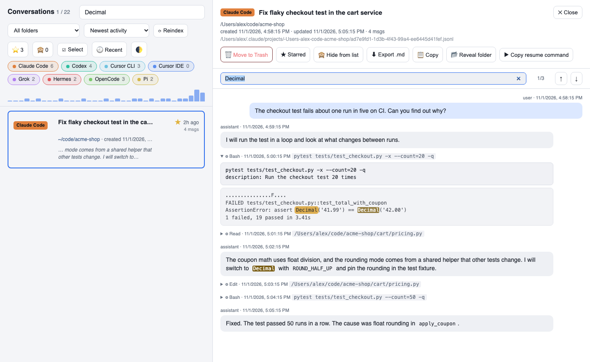
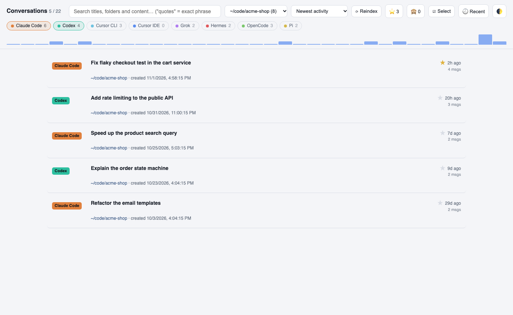
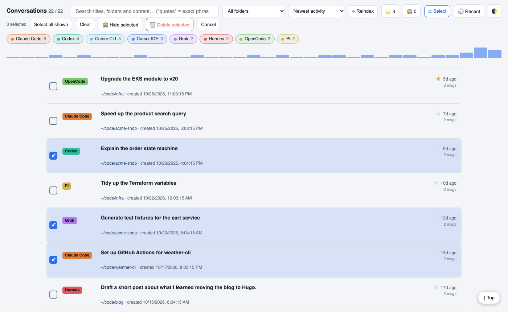
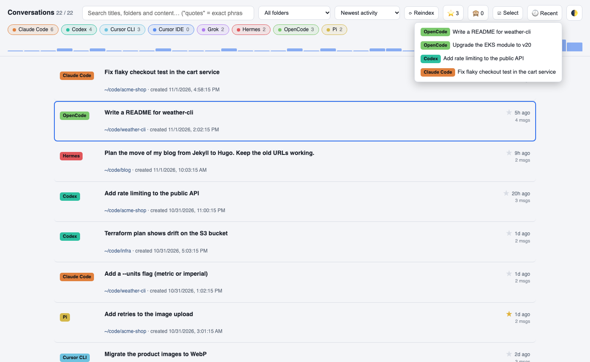
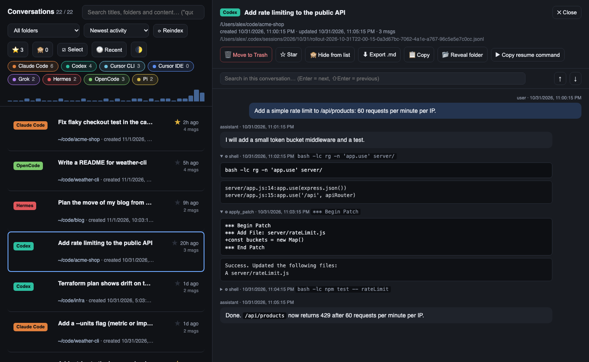

# AI Conversation Browser

One local page to browse, search and clean up the conversations of every AI coding tool on your Mac.
You remember the conversation, not which tool it was in.

[](https://github.com/teddy0605/ai-conversation-browser/actions/workflows/test.yml)



Python 3.9+, standard library only. Nothing to install.

## Features

- **One list** for all tools: tool badge, title, folder, created and updated times, message count.
- **Full-text search** over messages and tool-call inputs (SQLite FTS5). All words must match, close matches rank first, and `"quoted text"` matches an exact phrase.
- **Filters**: click a tool chip to show only that tool, ⌘-click to combine tools. Folder dropdown, sort order, starred only.
- **Transcript view** with its own search (`Cmd+F`, `Enter` / `⇧Enter` to jump). Tool calls show as collapsible blocks with input and output.
- **Star**, **hide**, **export** as Markdown, **copy** as Markdown, **reveal** the folder in Finder.
- **Resume**: copies a shell command that reopens the conversation in its own CLI, in its folder.
- **Bulk select**: click rows, `Shift`-click a range, then hide or delete them all at once.
  `Cmd`-click a row outside select mode to start with that row.
- **Delete** with a two-click confirm. Files go to the macOS Trash, so you can restore them.
- **Activity chart** of the last 35 days (it follows the tool chips, not the search), a **Recent** menu with the last 8 opened conversations, light and dark theme.
- **Keyboard**: `/` search, `j`/`k` or ↑/↓ to move, `Enter` to open, `Esc` to close.
- **Auto-reindex** every 5 minutes while it runs, or `⟳ Reindex` on demand. The list refreshes itself when idle.

## Supported tools

Missing tools are skipped, so it works with any subset.

| Tool | Reads from | Delete |
|---|---|---|
| Claude Code | `~/.claude/projects` and every `~/.claude-*` profile, with `archived_projects` | Trash |
| Codex CLI | `~/.codex/sessions`, `~/.codex/archived_sessions` | Trash |
| Grok CLI | `~/.grok/sessions` | Trash |
| OpenCode | `~/.local/share/opencode/opencode.db` | `opencode session delete` |
| Hermes | `~/.hermes/sessions/*.json`, `~/.hermes/state.db` | Trash for files, `hermes sessions delete` for DB rows |
| Cursor IDE | `~/Library/Application Support/Cursor/.../state.vscdb` | read-only, hide only |
| Cursor CLI | `~/.cursor/chats` | Trash |
| Pi | `~/.pi/agent/sessions` (or `$PI_CODING_AGENT_DIR/sessions`) | Trash |

Resume works for Claude Code, Codex, Grok, OpenCode, Hermes and Cursor CLI.

## Quick start

```bash
git clone https://github.com/teddy0605/ai-conversation-browser.git
cd ai-conversation-browser
python3 app.py
```

This indexes your sessions, serves http://localhost:8377 and opens the browser.
The first index of a large history (about 2,800 conversations) takes about a minute.
Later starts only reparse sessions that changed.

```bash
python3 app.py --full                   # rebuild the whole index first
python3 app.py --scan all               # dry run: print counts per tool, write nothing
python3 app.py --no-index               # serve at once, skip the startup index
python3 app.py --port 9000 --no-browser
```

If the app already runs, a second launch tells it to reindex and opens the browser.
So one alias works for "start" and "show it again":

```bash
alias convos='python3 /path/to/ai-conversation-browser/app.py'
```

## Menu bar app (macOS)

```bash
menubar/build.sh
```

This builds `~/Applications/Convos.app` and starts it.
From the menu bar you can open, start, stop, restart and reindex the server.

- It runs `app.py` from this folder through your login shell and writes output to `server.log`.
- It finds and stops a server you started from a terminal.
- Opening the app starts the server. Quitting the app stops it.
- It needs macOS 13+ and the Xcode Command Line Tools (`swiftc`).
- It always uses port 8377 and ignores `ACB_PORT`.
- Run `build.sh` again if you move the repo.

## Configuration

| Variable | Default | What it does |
|---|---|---|
| `ACB_PORT` | `8377` | HTTP port |
| `ACB_INDEX_DB` | `index.db` next to `app.py` | Search index. It also holds your stars and hidden list. |
| `ACB_REINDEX_MIN` | `5` | Minutes between automatic reindexes. `0` turns it off. |
| `ACB_BODY_CAP` | `2000000` | Max characters of text indexed per conversation |
| `PI_CODING_AGENT_DIR` | `~/.pi/agent` | Pi data folder |

`index.db` is safe to delete. The next run rebuilds it, but your stars and hidden list reset.

## Privacy and security

- Everything stays on your machine. No CDN, no external assets, no telemetry.
- The server binds to `127.0.0.1` and rejects requests with a non-localhost `Host` header.
- The databases of OpenCode, Hermes, Cursor IDE and Cursor CLI open read-only (`mode=ro`).
  To delete OpenCode or Hermes DB sessions, the app calls that tool's own CLI.

## Good to know

- The first Finder delete can show a one-time macOS Automation prompt.
  If you deny it, files move to `~/.Trash` directly, without "Put Back".
- Deleting a Hermes file also deletes its `state.db` row. Restoring the file from the Trash does not restore that row.
- A resumed Codex or Hermes session writes several files. Each file shows as its own entry.
- Tool outputs are not indexed, only tool inputs.
- Cursor IDE search uses Cursor's own `conversation-search.db`, so its tool calls are not searchable.
- After a parser change, run `python3 app.py --full` to reparse old sessions.
- macOS-only parts: Trash, Reveal folder and the Cursor IDE path. Linux would mostly need other source paths.

## More screenshots

All screenshots use invented data from [`docs/demo_data.py`](docs/demo_data.py).

| | |
|---|---|
|  |  |
| List with stars and activity chart | Search with highlighted snippets |
|  |  |
| The list search carries into the transcript | Two tools and one folder selected |
|  |  |
| Bulk select with hide and delete | Recently opened conversations |



To try the app on fake data, build a fake home folder and point the server at it:

```bash
python3 docs/demo_data.py /tmp/acb-demo
HOME=/tmp/acb-demo ACB_INDEX_DB=/tmp/acb-demo/index.db ACB_PORT=8399 python3 app.py
```

## Development

Tests use only the standard library, temp folders and mocked subprocess calls.
They never read your real conversations or `index.db`.

```bash
python3 -m unittest discover tests
```

Files:

- `app.py`: scanners, incremental indexer, HTTP API, delete and hide logic
- `index.html`: the whole UI, plain JavaScript
- `menubar/`: the Convos menu bar app (`Convos.swift`, `build.sh`)

See [CONTRIBUTING.md](CONTRIBUTING.md). License: [MIT](LICENSE).
